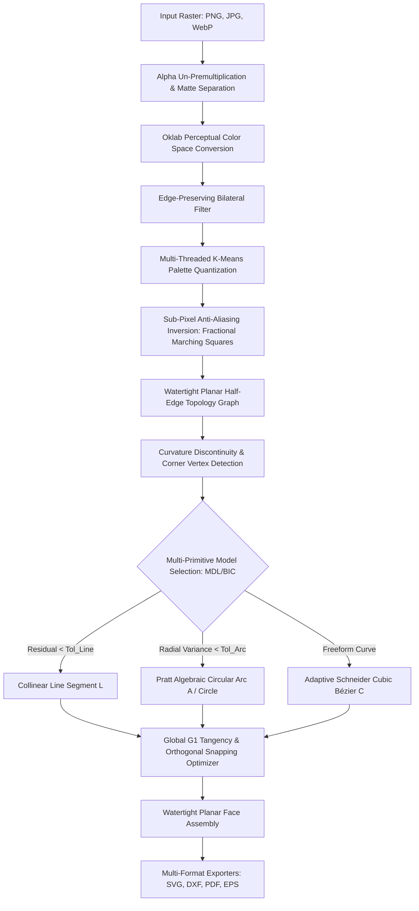

# Vectorizer Desktop: Comprehensive Technical Specification & Architecture Document (RFC-001)
*High-Performance Windows Desktop Vectorization Engine (100% Algorithmic Match to Vectorizer.ai)*

---

## 1. Executive Summary & Product Vision

### 1.1. Problem Statement
Existing open-source vectorizers (e.g., Potrace, AutoTrace, Inkscape Trace) were designed in the 1990s and 2000s for monochrome bitmap tracing. When applied to modern multi-color logos, illustrations, or CAD blueprints, they exhibit fatal deficiencies:
1. **Wobbly Geometry**: Perfect circles and straight lines turn into 16–32 wobbly cubic Bézier segments.
2. **Pixel Stair-Stepping**: Binary thresholding discards sub-pixel anti-aliasing information, leaving jagged pixel artifacts.
3. **White Hairline Seams & Bleed**: Tracing each color region independently produces mismatched borders that render with ugly white gaps or overlapping overlaps.
4. **Single Primitive Output**: Everything is converted to Béziers; native circular arcs (`A`) and straight lines (`L`) are lost, ruining CAD and CNC compatibility.

### 1.2. Product Objective
Build **Vectorizer Desktop**: a standalone, ultra-lightweight (<15 MB installer) Windows application written in **Rust** and **Tauri v2** that replicates the exact mathematical pipeline of **Vectorizer.ai** / **Vector Magic**. 
- **100% Local Execution**: Zero external cloud APIs, zero bulky neural network runtimes (no 2 GB PyTorch/CUDA overhead).
- **Blazing Speed**: Sub-350 ms vectorization for 1024×1024 images using Rayon multi-core data parallelism.
- **Flawless Geometry**: Emits native straight lines (`L`), native circular arcs (`A`), full circles (`<circle>`), and curvature-continuous cubic Béziers (`C`).
- **Watertight Topology**: Shared half-edge planar graph guaranteeing **zero seams and zero overlapping bleed**.
- **Professional Formats**: Export to clean SVG, AutoCAD DXF (R12/AC1015), PDF, and EPS.

---

## 2. Mathematical & Algorithmic Foundations



### 2.1. Bayesian Anti-Aliasing Inversion (Diebel's Stanford Formulation)
When a 2D vector graphic $V$ is rasterized onto a discrete pixel sensor grid, an edge pixel $I(x, y)$ is created by convolving the continuous boundary with a spatial point spread function (PSF):
$$I(x, y) = \iint_{\text{pixel}} \text{Rasterize}(V)(u, v) \, du \, dv$$

Along an anti-aliased transition between color $C_1$ and color $C_2$, the pixel value is a linear combination of the two colors parameterized by the fractional coverage area $\alpha \in [0, 1]$:
$$I(x, y) = \alpha(x, y) \cdot C_1 + (1 - \alpha(x, y)) \cdot C_2$$

Traditional tools round $\alpha$ to $0$ or $1$ (binary thresholding at 50%), discarding all spatial information. Our engine inverts this relation:
$$\alpha(x, y) = \frac{\langle I(x, y) - C_2, \, C_1 - C_2 \rangle}{\|C_1 - C_2\|^2}$$

Using the continuous scalar field $\alpha(x, y)$, boundary coordinates are extracted via **Fractional Marching Squares**. For a grid edge between pixel $p_0 = (x_0, y_0)$ with value $v_0$ and pixel $p_1 = (x_1, y_1)$ with value $v_1$, the exact sub-pixel boundary point $P \in \mathbb{R}^2$ at iso-level $0.5$ is:
$$P = p_0 + \frac{0.5 - v_0}{v_1 - v_0} \cdot (p_1 - p_0)$$
This produces a sub-pixel continuous polyline $(p_0, p_1, \dots, p_n)$ with floating-point precision, eliminating all pixel stair-stepping.

### 2.2. Perceptual Color Quantization in Oklab Space
Color clustering in standard sRGB or CIELAB suffers from non-uniform perceptual distances and hue shift during lightness adjustments. We use **Oklab** (Björn Ottosson, 2020):
1. **sRGB $\to$ Linear RGB**:
   $$C_{\text{linear}} = \begin{cases} \frac{C}{12.92} & C \le 0.04045 \\ \left(\frac{C + 0.055}{1.055}\right)^{2.4} & C > 0.04045 \end{cases}$$
2. **Linear RGB $\to$ LMS Cone Response**:
   $$\begin{bmatrix} l \\ m \\ s \end{bmatrix} = \begin{bmatrix} 0.4122214708 & 0.5363325363 & 0.0514459929 \\ 0.2119034982 & 0.6806995451 & 0.1073969566 \\ 0.0883024619 & 0.2817188376 & 0.6299787005 \end{bmatrix} \begin{bmatrix} r \\ g \\ b \end{bmatrix}$$
3. **Non-linear Transformation & Oklab Coordinates**:
   $$l' = \sqrt[3]{l}, \quad m' = \sqrt[3]{m}, \quad s' = \sqrt[3]{s}$$
   $$\begin{bmatrix} L \\ a \\ b \end{bmatrix} = \begin{bmatrix} 0.2104542553 & 0.7936177850 & -0.0040720468 \\ 1.9779984951 & -2.4285922050 & 0.4505937099 \\ 0.0259040371 & 0.7827717662 & -0.8086757660 \end{bmatrix} \begin{bmatrix} l' \\ m' \\ s' \end{bmatrix}$$

Perceptual color distance $\Delta E_{\text{ok}} = \sqrt{(L_1 - L_2)^2 + (a_1 - a_2)^2 + (b_1 - b_2)^2}$ is used throughout K-Means clustering, guaranteeing uniform color differentiation across all hues and brightness levels.

### 2.3. Watertight Planar Map (Half-Edge Topology)
To guarantee zero seams (no white cracks) and zero overlapping bleed:
1. Every shared boundary segment between Color Face $A$ and Color Face $B$ is represented as a single, directed **Half-Edge pair**: $e_{A \to B}$ and $\text{twin}(e_{A \to B}) = e_{B \to A}$.
2. The geometric primitive (Line, Arc, or Bézier) is fitted **once** for the edge.
3. When constructing the SVG path for Face $A$, the primitive is evaluated forward ($P_{\text{start}} \to P_{\text{end}}$). When constructing Face $B$, the exact same curve is evaluated backward ($P_{\text{end}} \to P_{\text{start}}$).
4. Multi-color junctions (where 3+ color regions meet) are snapped to a single topological vertex $V = (x, y)$.

### 2.4. Multi-Primitive Fitting & Selection

#### 2.4.1. Collinear Straight Line Fitting (`L`)
For a point sequence $p_1, \dots, p_N$:
- Fit best-fit line $a x + b y + c = 0$ using Total Least Squares (Principal Component Analysis / SVD).
- Maximum orthogonal residual: $\epsilon_{\max} = \max_i |a x_i + b y_i + c|$.
- **Angle Snapping**: If line orientation $|\theta - \theta_k| < 2^\circ$ for $\theta_k \in \{0^\circ, 45^\circ, 90^\circ, 135^\circ, 180^\circ\}$, the line is snapped to exact angle $\theta_k$.
- Emits: SVG `L x y`.

#### 2.4.2. Pratt Algebraic Circle & Circular Arc Fitting (`A`)
Traditional circle fitters (Kåsa) suffer from severe bias on partial arcs. We implement **Pratt's Algebraic Circle Fitting** algorithm:
- General circle equation: $A(x^2 + y^2) + Bx + Cy + D = 0$.
- Pratt constraint: $B^2 + C^2 - 4AD = 1$.
- Let $z_i = x_i^2 + y_i^2$. The data matrix $X = \begin{bmatrix} z_i & x_i & y_i & 1 \end{bmatrix}$. We solve the generalized eigenvalue problem:
  $$X^T X \, \mathbf{u} = \lambda \, B_{\text{pratt}} \, \mathbf{u}$$
- Center coordinates: $x_c = -B / (2A)$, $y_c = -C / (2A)$. Radius: $R = \sqrt{B^2 + C^2 - 4AD} / (2|A|)$.
- Radial variance test: $\sigma_R = \sqrt{\frac{1}{N}\sum_{i=1}^N (\|p_i - (x_c, y_c)\| - R)^2}$. If $\sigma_R < \epsilon_{\text{arc}}$, accept circle/arc.
- Full circle test: If sweep angle $\Delta \theta \ge 355^\circ$, emit native SVG `<circle cx="xc" cy="yc" r="R" />`.
- Arc test: If $\Delta \theta < 355^\circ$, calculate large-arc flag ($f_A = 1$ if $\Delta \theta > 180^\circ$ else $0$) and sweep flag ($f_S$).
- Emits: SVG `A R R 0 f_A f_S x y`.

#### 2.4.3. Adaptive Schneider Cubic Bézier Spline Fitting (`C`)
For freeform non-circular curves:
- Fit cubic Bézier $B(t) = (1-t)^3 P_0 + 3(1-t)^2 t P_1 + 3(1-t) t^2 P_2 + t^3 P_3$.
- Compute chord-length parameterization $t_i$.
- Calculate tangent directions $\hat{t}_1$ and $\hat{t}_2$ at endpoints.
- Solve $2\times 2$ linear system for control point distances $\alpha_1, \alpha_2$:
  $$P_1 = P_0 + \alpha_1 \hat{t}_1, \quad P_2 = P_3 - \alpha_2 \hat{t}_2$$
- If maximum deviation $\max_i \|B(t_i) - p_i\| > \epsilon_{\text{bezier}}$, split contour at index of maximum error and recurse.
- Emits: SVG `C x1 y1 x2 y2 x y`.

#### 2.4.4. Model Selection Criterion (Minimum Description Length - MDL)
To select between Line, Arc, and Bézier, compute the MDL cost function:
$$\text{Cost}(M) = \sum_{i=1}^N \text{dist}(p_i, M)^2 + \lambda \cdot \text{Complexity}(M)$$
- $\text{Complexity}(\text{Line}) = 2$ parameters
- $\text{Complexity}(\text{Arc}) = 3$ parameters
- $\text{Complexity}(\text{Bézier}) = 6$ parameters
This mathematically ensures the simplest, cleanest geometric primitive is always chosen.

### 2.5. $G^1$ Tangent Continuity Optimization
At joint vertices where two primitives meet (e.g., Line meets Arc, or Arc meets Bézier):
- If the angle between the two primitive tangent vectors $|\angle(\hat{t}_{\text{out}}, \hat{t}_{\text{in}})| < 10^\circ$, enforce **$G^1$ continuity**:
  $$\hat{t}_{\text{common}} = \frac{\hat{t}_{\text{out}} + \hat{t}_{\text{in}}}{\|\hat{t}_{\text{out}} + \hat{t}_{\text{in}}\|}$$
  The adjoining primitive control points or arc tangents are projected onto $\hat{t}_{\text{common}}$, eliminating visual kinks.

---

## 3. System Architecture & Crate Structure

```text
d:\Poject\vectorizer\
├── Cargo.toml                          # Workspace root (resolver = "2")
├── crates/
│   ├── vectorizer-core/                # Pure computational geometry engine (lib)
│   │   ├── Cargo.toml
│   │   └── src/
│   │       ├── lib.rs                  # Public API & VectorizerPipeline
│   │       ├── color/
│   │       │   ├── mod.rs
│   │       │   ├── oklab.rs            # SIMD/Rayon Oklab color conversion
│   │       │   ├── bilateral.rs        # Edge-preserving bilateral filter
│   │       │   └── kmeans.rs           # Fast parallel K-Means palette quantizer
│   │       ├── subpixel/
│   │       │   ├── mod.rs
│   │       │   ├── alpha_matte.rs      # Alpha channel un-premultiplication
│   │       │   ├── distance_field.rs   # Anti-aliasing gradient inversion
│   │       │   └── marching_squares.rs # Fractional continuous marching squares
│   │       ├── topology/
│   │       │   ├── mod.rs
│   │       │   ├── half_edge.rs        # Planar map half-edge data structure
│   │       │   ├── planar_graph.rs     # Watertight boundary graph builder
│   │       │   └── stacking.rs         # Planar Cutout vs Stacked Layer modes
│   │       ├── primitives/
│   │       │   ├── mod.rs
│   │       │   ├── line.rs             # Collinear line fitter + angle snapping
│   │       │   ├── circle_arc.rs       # Pratt algebraic circle & arc fitter
│   │       │   ├── bezier.rs           # Schneider adaptive cubic Bézier fitter
│   │       │   └── classifier.rs       # MDL model selector
│   │       ├── optimizer/
│   │       │   ├── mod.rs
│   │       │   ├── corner.rs           # Curvature corner & junction detector
│   │       │   └── tangency.rs         # G1 tangent continuity solver
│   │       └── exporters/
│   │           ├── mod.rs
│   │           ├── svg.rs              # Clean semantic SVG with primitive classes
│   │           ├── dxf.rs              # AutoCAD AC1015 TrueColor DXF exporter
│   │           ├── pdf.rs              # Vector PDF exporter
│   │           └── eps.rs              # Encapsulated PostScript exporter
│   └── vectorizer-cli/                 # High-speed CLI binary for testing & batch runs
│       ├── Cargo.toml
│       └── src/main.rs
├── src-tauri/                          # Tauri v2 Windows desktop application backend
│   ├── Cargo.toml
│   ├── tauri.conf.json
│   └── src/
│       ├── main.rs
│       └── commands.rs                 # Tauri IPC command handlers
└── ui/                                 # High-performance desktop studio UI
    ├── index.html                      # Dark-mode professional layout
    ├── style.css                       # Modern desktop UI styling
    ├── app.js                          # State management & Tauri IPC bridge
    ├── canvas_viewer.js                # Dual-canvas & split-screen zoom/pan engine
    └── primitive_inspector.js          # Color-coded primitive inspection overlay
```

---

## 4. Export Formats Specification

### 4.1. Clean SVG Specification
- Clean, semantic SVG syntax formatted with precision up to 3 decimal places.
- Support for `<svg viewBox="...">`, `<path d="...">`, `<circle cx="..." cy="..." r="..." />`.
- Semantic primitive classes (`class="v-line"`, `class="v-arc"`, `class="v-bezier"`) to enable instant DOM-level debugging and styling.

### 4.2. AutoCAD DXF Specification (AC1015 / Release 2000)
- Organized with **Color-by-Layer**: each quantized color is placed on a dedicated layer (`LAYER_01_#HEX`).
- Native CAD entities:
  - Straight segments $\to$ `LINE` (group codes 10, 20, 11, 21).
  - Circular arcs $\to$ `ARC` (group codes 10, 20, 40, 50, 51: center, radius, start angle, end angle).
  - Full circles $\to$ `CIRCLE` (group codes 10, 20, 40: center, radius).
  - Splines $\to$ `SPLINE` (degree 3 cubic Bézier with fit points and knots).
- Configurable units: Millimeters (`$INSUNITS = 4`), Centimeters (`$INSUNITS = 5`), Inches (`$INSUNITS = 1`), or Unitless.

### 4.3. PDF & EPS Specification
- Standard PostScript operators: `moveto`, `lineto`, `curveto`, `arc`, `closepath`, `fill`.
- RGB color space specification with exact floating-point color fills (`r g b rg` / `setrgbcolor`).

---

## 5. Desktop Studio UI Specification

### 5.1. Dual View & Split-Slider Modes
- **Synchronized Dual Canvas**: Left pane displays original raster bitmap; right pane displays live vector SVG. Panning or zooming on either canvas locks the counterpart to identical coordinates and zoom level (up to 6400% zoom).
- **Interactive Split Slider**: A draggable vertical divider overlays the raster bitmap directly over the rendered SVG, allowing pixel-perfect before/after validation.

### 5.2. Interactive Primitive Inspector
When toggled on via the top bar or hotkey (`I`):
- 🔵 **Bright Blue** (`#00BFFF`): Straight Line segments (`L`)
- 🟢 **Vibrant Green** (`#00E676`): Native Circular Arcs (`A`) and Full Circles (`<circle>`)
- 🟠 **Warm Orange** (`#FF9100`): Adaptive Cubic Béziers (`C`)
- 🔴 **Red Dots** (`#FF1744`): Corner vertices and multi-color topological junction nodes
- **HUD Diagnostics Panel**: Displays live statistics:
  - Total processing time (ms)
  - Color palette count
  - Primitives breakdown: Count of Lines, Arcs, Béziers, and Nodes
  - Memory consumption and output file size

### 5.3. Parameter Controls & Presets
- **Preset Selector**:
  - `CAD / Technical`: Tight line tolerance (0.3 px), high arc sensitivity, aggressive orthogonal snapping.
  - `Balanced / Default`: Standard tolerance (0.8 px), balanced arc fitting, natural curvature.
  - `Artistic / Smooth`: Loose tolerance (1.5 px), smooth Béziers, minimal micro-paths.
- **Advanced Sliders**:
  - Palette Colors ($K \in [2, 64]$)
  - Line Fitting Tolerance ($\epsilon_{\text{line}} \in [0.1, 3.0]$ px)
  - Arc Sensitivity ($\epsilon_{\text{arc}} \in [0.1, 2.0]$ px)
  - Corner Sharpness Angle ($\theta_{\text{corner}} \in [90^\circ, 160^\circ]$)
  - Topology Mode: Toggle between **Cutout Planar Map** (0 overlaps) and **Stacked Layers** (for vinyl/cutter).

### 5.4. Multi-Core Parallel Batch Queue
- Drag-and-drop entire folders or multi-file selections.
- Parallel processing worker pool utilizing all available CPU cores.
- Status cards per image: thumbnail preview, status badge (Queued, Processing, Completed), vector primitive counts, and one-click bulk export.

---

## 6. Verification & Quality Acceptance Matrix

| Test Category | Target Test Case | Acceptance Criteria |
| :--- | :--- | :--- |
| **Geometry** | Perfect Circle & Ring Icon | Must produce `<circle>` or SVG `A` arc commands. Residual $< 0.05$ px. Zero wobbly Béziers. |
| **Lines** | Blueprint / Architectural Plan | Must produce straight `L` commands. Lines within $2^\circ$ must snap to exact $0^\circ, 45^\circ, 90^\circ$. |
| **Topology** | Multi-colored Flag / Logo | Zooming to 3200% must show **0 white hairline seams** and **0 overlapping bleed** between adjacent color shapes. |
| **Alpha** | Transparent Sticker / Icon | Must have 0 black/white fringing around transparent cutouts. Transparent areas must remain empty. |
| **CAD Export** | DXF in AutoCAD / LibreCAD | Must open with zero errors, color layers mapped, native `ARC` and `LINE` entities present. |
| **Performance** | 1024×1024 Raster Image | Total vectorization time on multi-core CPU $< 350$ ms. Total desktop RAM $< 120$ MB. |
| **Packaging** | Windows Tauri v2 Binary | Standalone installer / executable size $< 15$ MB. Zero external runtimes required. |
